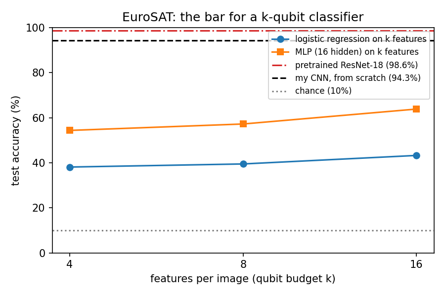
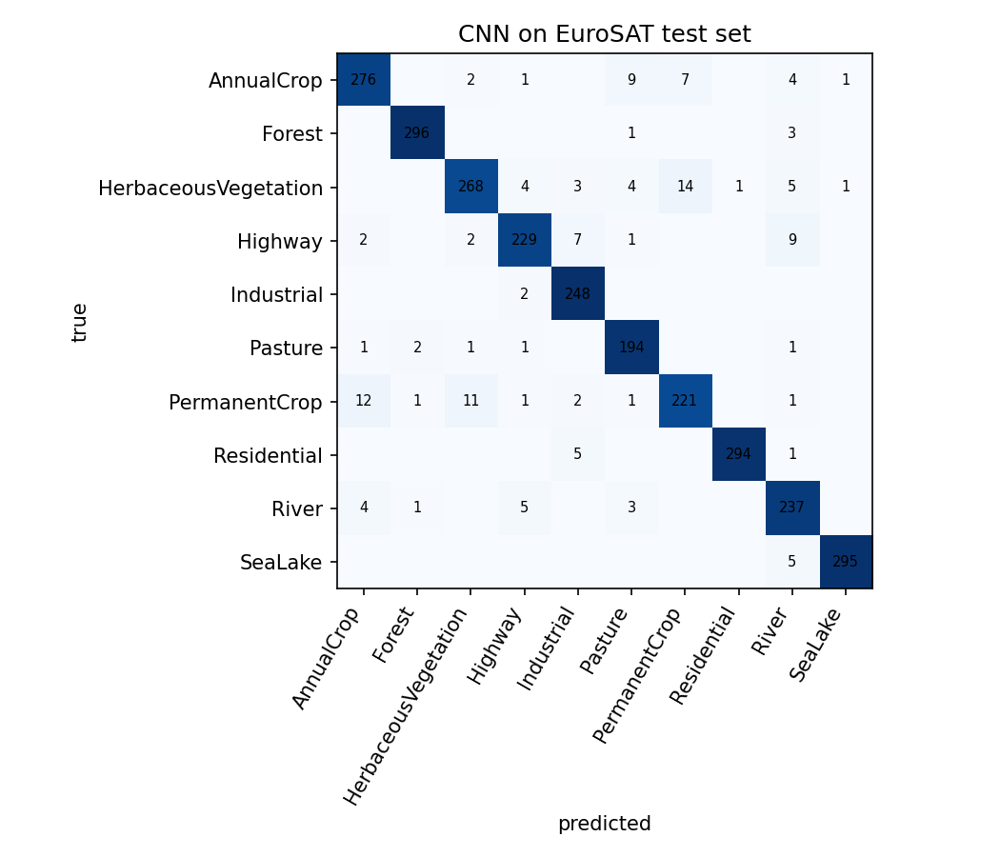

# Classical baselines for quantum classifiers on EuroSAT

Before a quantum classifier for satellite images can be called useful, it has to beat a fair classical baseline. This repository measures that bar on **EuroSAT**, the Sentinel-2 land-cover dataset (27,000 RGB images of 64×64 pixels, 10 classes) used in hybrid quantum CNN studies for Earth observation.

Three baselines, one fixed stratified split (80% train, 10% validation, 10% test, seed 42):

1. **My CNN, trained from scratch.** The network I built for CIFAR-10 in my deep learning course at Sorbonne Université (RDFIA), adapted to 64×64 inputs and trained only on EuroSAT, over 3 seeds.
2. **Reference ceiling.** An ImageNet-pretrained ResNet-18, fine-tuned on the same split.
3. **Qubit-budget baselines.** Each image compressed to *k* = 4, 8 or 16 PCA features, the input size of a *k*-qubit classifier with angle encoding, then classified by a logistic regression or a small MLP with a few hundred parameters.

## Results

Test set of 2,700 images. Chance is 10%.

| Model | Input per image | Parameters | Test accuracy |
|---|---|---:|---:|
| ResNet-18, ImageNet-pretrained, fine-tuned | 224×224 (upscaled) | 11,181,642 | **98.59%** (1 seed) |
| My CNN, from scratch | 64×64 RGB | 4,263,490 | **94.27% ± 0.55** (3 seeds) |
| MLP, 16 hidden units | 16 PCA features | 442 | 63.85% |
| MLP, 16 hidden units | 8 PCA features | 314 | 57.22% |
| MLP, 16 hidden units | 4 PCA features | 250 | 54.37% |
| Logistic regression | 16 PCA features | 170 | 43.26% |
| Logistic regression | 8 PCA features | 90 | 39.48% |
| Logistic regression | 4 PCA features | 50 | 38.11% |

The 3 CNN runs scored 93.67%, 94.41% and 94.74%. The pretrained ResNet-18 matches the 98.57% that Helber et al. (2019) report with a fine-tuned ResNet-50, which is a check that the split and pipeline are sound.

## What the numbers say

1. **Compression costs more than the classifier.** 16 PCA features keep 81.4% of the pixel variance, yet the best small model on them reaches 63.85%, 30.4 points below the full-image CNN. For a 16-qubit classifier fed such features, the fair bar is at least 63.85%, not 94%.
2. **A quantum model must be compared with a non-linear classical model of similar size.** At every *k*, the MLP beats logistic regression by 16 to 21 points with only a few hundred parameters. Beating a linear baseline alone shows little.
3. **Pretraining is worth 4.3 points.** The from-scratch CNN trails the pretrained ResNet-18 by 4.32 points with 38% of its parameters.
4. **The hard classes are agricultural.** In the CNN's confusion matrix (seed 2), PermanentCrop (88.4%) and HerbaceousVegetation (89.3%) are the weakest and are mostly confused with each other and with AnnualCrop.

## Method

- **Data.** EuroSAT RGB via torchvision, loaded once into memory. Per-channel mean and standard deviation computed on the training images only.
- **Augmentation.** Satellite patches have no "up", so all 8 combinations of flips and 90° rotations are valid, unlike on CIFAR-10.
- **CNN.** Three 5×5 convolutions (32, 64, 64 filters) with batch norm, ReLU and max-pooling, then a 1,000-unit layer with dropout 0.5. SGD, learning rate 0.1, exponential decay 0.95, 30 epochs, batch 128.
- **ResNet-18.** Images upscaled to 224×224 and normalised with ImageNet statistics. SGD with momentum 0.9, learning rate 0.01, cosine schedule, 10 epochs, mixed precision.
- **Model selection.** For every model, the epoch with the best validation accuracy is kept; the test set is used once at the end.
- **Qubit budgets.** Images averaged down to 32×32 (3,072 values), projected onto the first *k* principal components fitted on the training set, then standardised.

## Limitations

- **PCA is one compression among many.** Hybrid quantum CNNs usually put a classical convolutional front end before a small quantum layer; the matching baseline is a learned *k*-feature bottleneck, which would retain more information than PCA. That is the natural next experiment.
- **The *k*-feature framing matches angle encoding.** Amplitude encoding packs 2^*k* values into *k* qubits, at the cost of deep state-preparation circuits.
- **The small models are lower bounds.** A larger classifier on the same *k* features could do better, so the bars above are minimums.
- **Training noise.** Validation accuracy of the CNN fluctuates between epochs (down to 80.5% late in training) because the learning rate stays high (0.021 after 30 epochs) and plain SGD has no momentum; the best-validation epoch is kept. The ResNet-18 was run with 1 seed.

## Reproduce

Open `eurosat_baselines.ipynb` in Google Colab, select a T4 GPU, and run all cells (about 35 minutes). Results are written to `results/`. Run here with PyTorch 2.14.1 on CUDA 13.0. Setting the environment variable `QUICK_TEST=1` runs the full notebook on fake data in a few minutes, to check the code.

## References

- P. Helber, B. Bischke, A. Dengel, D. Borth. *EuroSAT: A Novel Dataset and Deep Learning Benchmark for Land Use and Land Cover Classification.* IEEE JSTARS, 2019.
- J. Bowles, S. Ahmed, M. Schuld. *Better than classical? The subtle art of benchmarking quantum machine learning models.* arXiv:2403.07059, 2024.

## Author

Pablo González Lázaro, MSc Quantum Information, Sorbonne Université. MIT License.
